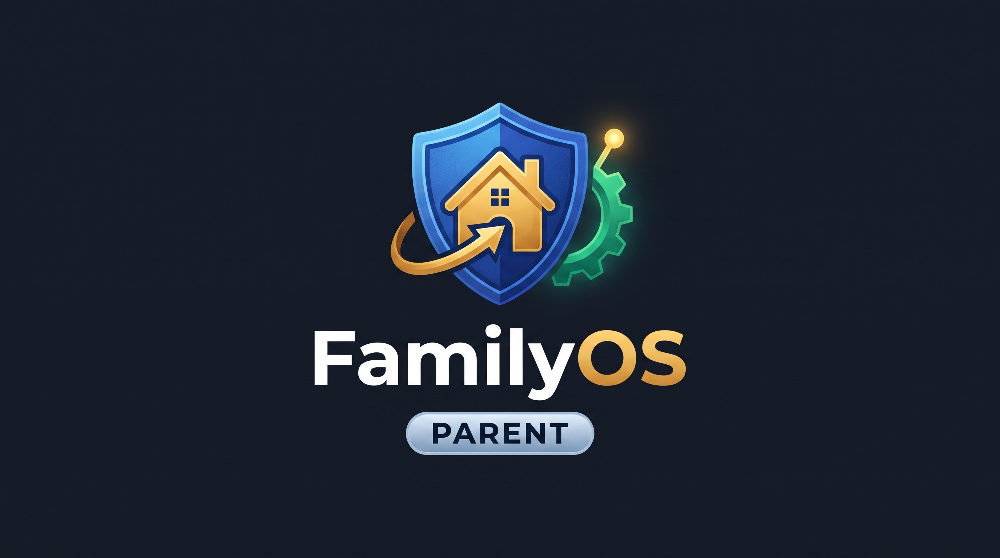
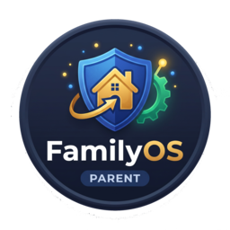
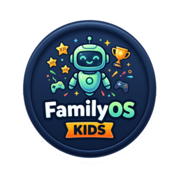

# 🦁 FamilyToStudy - Aile İçi Oyunlaştırma, Görev ve Odaklanma Ekosistemi

<p align="center">
  
</p>

<p align="center">
  
  
</p>

FamilyToStudy; çocukların günlük rutinlerini, ödevlerini ve sorumluluklarını eğlenceli hale getiren, ödül/puan ekonomisi barındıran, çoklu cihaz (PC, Tablet, Telefon) senkronizasyonlu, ebeveyn kontrollü ve gerçek zamanlı (Realtime WebSockets) çalışan bir **PWA (Progressive Web App)** ve **Windows Masaüstü Ajanı** sistemidir.

---

## 🏗️ Mimari ve Bileşenler

1. **Frontend PWA (Next.js 14, Tailwind CSS, Framer Motion, Web Audio API):**
   - GitHub Pages üzerinde statik (`output: 'export'`) olarak sunulur.
   - iOS 16.4+ ve Android Ana Ekran PWA kurulumu, Bas-Konuş Telsiz DM, Aktif Mola Ruleti, Adalet Divanı Sesli İtirazı, Haftalık Pazar Röportajı ve Fotoğraf/QR Kanıt doğrulama.
2. **Backend & Realtime (Supabase PostgreSQL, RPC & Storage):**
   - Atomik kalkan kırma, ilk kapar yarış görevleri kilitlenmesi, uzaktan ekran görüntüsü ve otomatik güncellemeler.
3. **Windows Masaüstü Endpoint Ajanı (`windows-agent/` - Python, PyQt6, win32gui, pycaw):**
   - Çift Ajanlı "İkiz Nöbetçi" (Mutual Watchdog & Anti-Kill) koruması (`FamilyOS_Agent.exe` + `FamilyOS_Guard.exe`).
   - Donanımsal Ses ve Audio Ducking (Türkçe TTS anonslarında oyun sesini %20'ye kısma).
   - Bilgisayarlı Ders Beyaz Liste Denetleyicisi (`WhitelistEnforcer`).
   - 20-20-20 Göz/Duruş Molası ve +3 Dk Kriz Önleyici Uzatma Jokeri.
   - Uzaktan Otomatik Güncelleyici (OTA Auto-Updater).

---

## 🚀 GitHub Pages Üzerinde PWA Yayını

Proje, GitHub Actions (`.github/workflows/deploy-pwa.yml`) ile `main` dalına yapılan her gönderimde (push) otomatik olarak statik dışa aktarılır (`./out`) ve GitHub Pages'te yayınlanır.

### GitHub Pages Kurulum Adımları:
1. Depo sayfasında **Settings** -> **Pages** sekmesine gidin.
2. **Build and deployment** başlığı altındaki **Source** seçeneğini **GitHub Actions** olarak ayarlayın.
3. Depo **Settings** -> **Secrets and variables** -> **Actions** bölümüne şu değişkenleri (isteğe bağlı) ekleyebilirsiniz:
   - `NEXT_PUBLIC_SUPABASE_URL`: Supabase proje URL adresiniz.
   - `NEXT_PUBLIC_SUPABASE_ANON_KEY`: Supabase anon/public anahtarınız.
   - `NEXT_PUBLIC_BASE_PATH`: Eğer proje `kullaniciadi.github.io/repo-adi` altında barındırılıyorsa `/repo-adi` (varsayılan: kök alan adı).

---

## 💻 GitHub Actions ile Otomatik Windows Ajanı (.EXE) Derleme

`.github/workflows/build-windows-agent.yml` iş akışı, `windows-agent/` klasöründe yapılan her push'ta veya manuel tetiklendiğinde (`workflow_dispatch`) GitHub'ın `windows-latest` bulut sunucusunda çalışır:

1. **PyInstaller Derlemesi:**
   - `FamilyOS_Agent.exe` (Ana Ajan & Gömülü WebEngine)
   - `FamilyOS_Guard.exe` (İkiz Nöbetçi Bekçi Süreci)
2. **Paketleme:**
   - İki çalıştırılabilir dosya ve yönetici izinli `Kurulum_Baslat.bat` kurulum betiği `FamilyOS_Windows_Package.zip` olarak paketlenir.
3. **İndirme:**
   - GitHub Actions **Artifacts** bölümünden doğrudan indirilebilir.
   - `v1.0.0` gibi bir Git Tag oluşturulduğunda otomatik olarak GitHub **Releases** altında yayınlanır.

---

## 📱 İki Bağımsız Mobil & Web Uygulaması (SOLID: Single Responsibility)

Ebeveyn ve çocuk cihazlarının ve mağaza paketlerinin birbirinden tamamen izole olması için ekosistem iki bağımsız uygulamaya ayrılmıştır:

### 1. 🛡️ FamilyToStudy Fam (Ebeveyn & Veli Portalı)
- **Giriş Noktası:** `ios-app/lib/main_fam.dart`
- **Paket Kimliği:** `com.familytostudy.fam`
- **Uygulama Logosu:** `public/family-logo.png` (Mavi/Altın Ebeveyn Kalkanı)
- **Giriş Yöntemleri:** Google OAuth Girişi, Aile Kodu & Ebeveyn PIN/Şifre, Yeni Aile Oluşturma Sihirbazı.
- **Kapsam:** Canlı çocuk kalkan denetimi, anlık uzaktan ekran kilidi, görev atama/onaylama, Adalet Divanı sesli itiraz kararları, çark ödül havuzu yönetimi.

### 2. 🧒 FamilyToStudy Kids (Öğrenci & Çocuk Portalı)
- **Giriş Noktası:** `ios-app/lib/main_kids.dart`
- **Paket Kimliği:** `com.familytostudy.kids`
- **Uygulama Logosu:** `public/kids-logo.png` (Kozmik Gezegen & Yıldız)
- **Giriş Yöntemleri:** Aile Kodu + Öğrenci Profil Seçimi + PIN veya 6 Haneli Eşleştirme Kodu (Örn: `889-891`). Ebeveyn giriş ve yönetim ekranları bu uygulamada bulunmaz.
- **Kapsam:** Oyunlaştırılmış ders kronometresi, rozetler, günlük çarkıfelek, Bas-Konuş telsiz, aktif molalar, donanımsal odak modu kalkanı ve uygulama küçültme/arka plana atma ihlal sensörü.

---

## 🍏 Flutter Native iOS & Web Derlemeleri (Fam & Kids)

`ios-app/` dizini altında barındırılan Flutter uygulamaları hem ayrı ayrı hem de test portalı üzerinden derlenebilir:

1. **Bağımsız Derlemeler:**
   - **Fam Uygulaması:** `flutter run -t lib/main_fam.dart` (veya `flutter build ios -t lib/main_fam.dart`)
   - **Kids Uygulaması:** `flutter run -t lib/main_kids.dart` (veya `flutter build ios -t lib/main_kids.dart`)
2. **GitHub Actions Otomasyonu:**
   - `.github/workflows/build-flutter-web.yml`: Hem `familytostudy-kids-web` hem `familytostudy-fam-web` paketlerini ayrı ayrı derleyip yayınlar.
   - `.github/workflows/build-ios-ipa.yml`: `FamilyToStudy_Kids.ipa` ve `FamilyToStudy_Fam.ipa` olmak üzere iki bağımsız `.ipa` üretir. Sideloadly veya AltStore ile doğrudan cihaza yüklenebilir.

---

## 🔒 Güvenlik Mimarisi ve Çevre Değişkenleri

1. **Sıfır-Gizli-Anahtar İlkesi (Zero Hardcoded Secrets):**
   - Kaynak kodda veya Git geçmişinde hiçbir `Secret Key` veya veritabanı şifresi tutulmaz.
   - İstemci ve Windows Masaüstü Ajanı yalnızca güvenli Supabase `Anon / Publishable Key` ile çalışır.
   - Yerel yapılandırma için `.env.example` dosyasını `.env.local` veya `windows-agent/.env` olarak çoğaltabilirsiniz.

2. **Dinamik Build Secrets:**
   - GitHub Actions üzerinden `.exe` derlenirken GitHub Secrets'tan gelen değerler `windows-agent/build_secrets.py` modülü aracılığıyla derleme anında doğrudan ikili `.exe` içine gömülür ve Git geçmişine sızmaz.

---

## 🛠️ Yerel Geliştirme

### PWA'yı Başlatma:
```bash
npm install
npm run dev
```

### Windows Ajanını Çalıştırma:
```bash
pip install -r windows-agent/requirements.txt
python windows-agent/main.py
```
